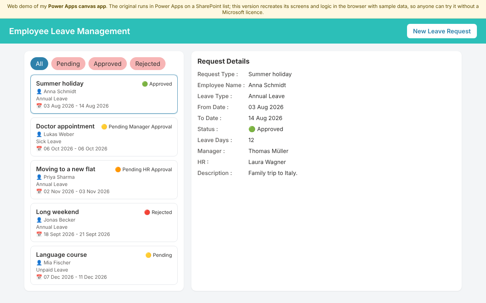
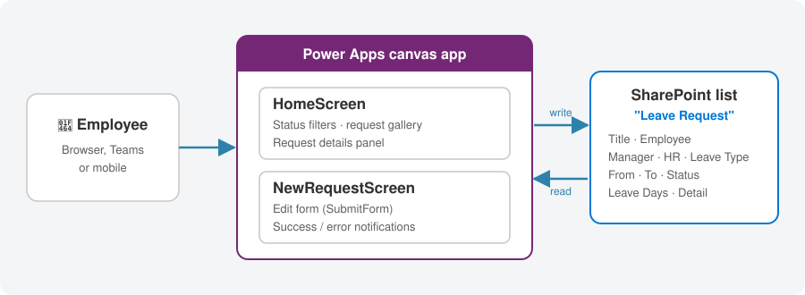
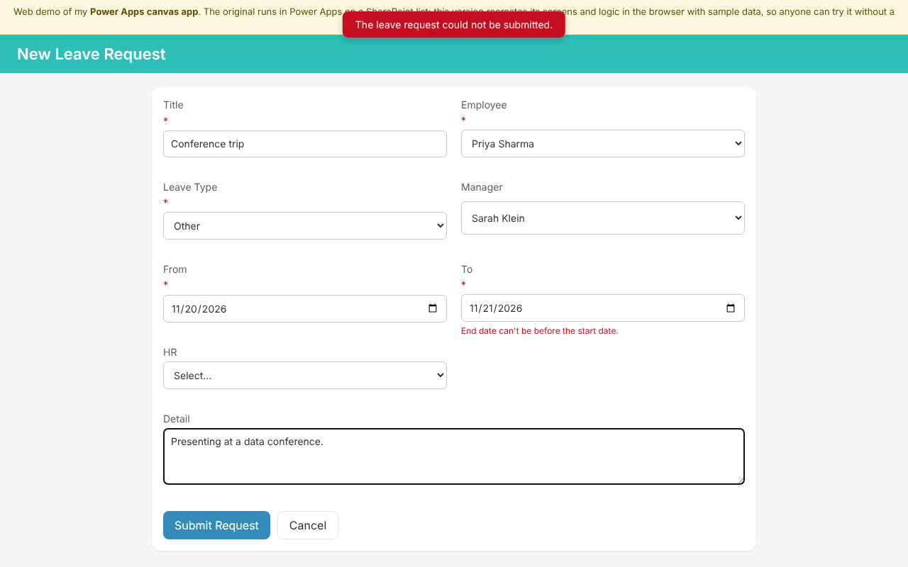
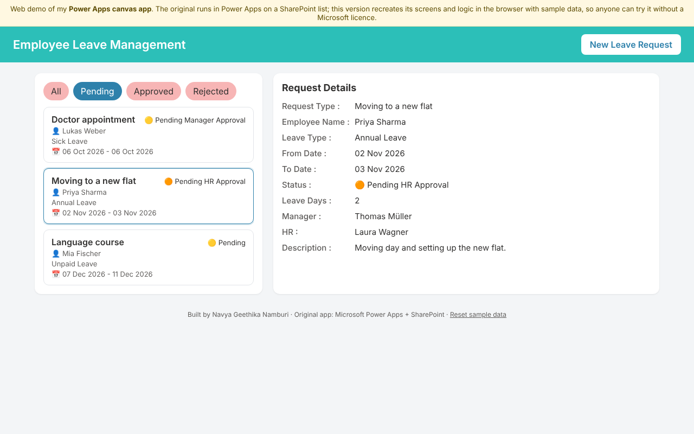

# Employee Leave Management App (Power Apps)

A Microsoft Power Apps canvas app where employees submit leave requests and follow their status in one place. Requests are stored in a SharePoint list.

  

### ▶️ [Try the live web demo](https://navya1223.github.io/Employee-Leave-Management/)

Power Apps needs a Microsoft 365 licence to run, so this repository also includes a **web version of the app** that recreates its screens and logic in plain HTML and JavaScript. It runs in any browser with sample data, so you can click through it without a Microsoft account.

<p align="center">
  
</p>

## Table of Contents

- [Features](#features)
- [Architecture](#architecture)
- [Screens and logic](#screens-and-logic)
- [Web demo](#web-demo)
- [Importing the app into Power Apps](#importing-the-app-into-power-apps)
- [Repository structure](#repository-structure)
- [Limitations and next steps](#limitations-and-next-steps)

## Features

- **Request list** showing every leave request with title, employee, leave type, dates and a colour-coded status
- **Status filters** for All, Pending, Approved and Rejected; "Pending" also covers "Pending Manager Approval" and "Pending HR Approval"
- **Details panel** for the selected request, including manager, HR contact, number of leave days and description
- **New request form** in two columns that saves straight to SharePoint, shows a success or error notification and refreshes the list
- **People and choice fields** (employee, manager, HR, leave type) taken directly from the SharePoint list columns

## Architecture

<p align="center">
  
</p>

| Component | Details |
| --- | --- |
| Front end | Power Apps canvas app with two screens |
| Data source | SharePoint list **Leave Request** (SharePoint connector) |
| Columns | Title, Employee (person), Manager (person), HR (person), Leave Type (choice), From, To (dates), Status (choice), Leave Days, Detail |

## Screens and logic

### HomeScreen

The gallery's `Items` property filters the list based on the selected status button:

```powerfx
Switch(
    varStatusFilter,
    "Approved", Filter('Leave Request', Status.Value = "Approved"),
    "Rejected", Filter('Leave Request', Status.Value = "Rejected"),
    "Pending",  Filter('Leave Request',
                    Status.Value = "Pending Manager Approval" ||
                    Status.Value = "Pending HR Approval" ||
                    Status.Value = "Pending"),
    'Leave Request'
)
```

Selecting a request stores it in a variable that the details panel reads:

```powerfx
// Gallery.OnSelect
Set(varSelectedRequest, galLeaveRequests.Selected)

// Status label in the details panel
Switch(
    varSelectedRequest.Status.Value,
    "Approved", "🟢 Approved",
    "Rejected", "🔴 Rejected",
    "Pending Manager Approval", "🟡 Pending Manager Approval",
    "Pending HR Approval", "🟠 Pending HR Approval",
    varSelectedRequest.Status.Value
)
```

### NewRequestScreen

An edit form bound to the SharePoint list. Submitting saves the record, and the result decides what happens next:

```powerfx
// "New Leave Request" button
NewForm(frmNewLeaveRequest); Navigate(NewRequestScreen, ScreenTransition.Fade)

// frmNewLeaveRequest.OnSuccess
Notify("Leave request submitted successfully.", NotificationType.Success);
Refresh('Leave Request');
ResetForm(frmNewLeaveRequest);
Navigate(HomeScreen, ScreenTransition.Fade)

// frmNewLeaveRequest.OnFailure
Notify("The leave request could not be submitted.", NotificationType.Error)
```

<p align="center">
  
</p>

## Web demo

[`index.html`](index.html) is a single-file web version of the app, published with GitHub Pages:

- It mirrors both screens, the status filter logic and the success and error messages of the Power Apps version.
- Sample employees, managers and leave types replace the SharePoint data; new requests are saved in your browser (localStorage). **Reset sample data** at the bottom restores the start state.
- It also adds two checks planned for the Power Apps version: required fields, and an end date that can't be before the start date.

<p align="center">
  
</p>

## Importing the app into Power Apps

You need a Power Apps licence (the free [Power Apps Developer Plan](https://powerapps.microsoft.com/developerplan/) works) and a SharePoint site.

1. Create a SharePoint list named **Leave Request** with the columns listed in [Architecture](#architecture).
2. Go to [make.powerapps.com](https://make.powerapps.com) → **Apps** → **Import canvas app**, and upload [`power-apps/EmployeeLeaveManagement_package.zip`](power-apps/EmployeeLeaveManagement_package.zip).
3. During import, connect the SharePoint connection to your own site and list.

The readable source of every screen (Power Fx in YAML) is in [`power-apps/source`](power-apps/source).

## Repository structure

```
Employee-Leave-Management/
├── index.html                         # Web demo (GitHub Pages)
├── images/                            # Screenshots and architecture diagram
└── power-apps/
    ├── EmployeeLeaveManagement_package.zip   # Exported Power Apps package
    └── source/                        # Screen source code (Power Fx, .pa.yaml)
        ├── App.pa.yaml
        ├── HomeScreen.pa.yaml
        └── NewRequestScreen.pa.yaml
```

## Limitations and next steps

- **Approvals:** statuses exist, but managers can't approve or reject in the app yet. Next step: a Power Automate approval flow that starts when a request is created, plus Approve/Reject buttons for managers.
- **Validation:** form fields are optional in the Power Apps version, and the end date isn't checked against the start date (both are added in the web demo).
- **Employee field:** employees pick their own name; it should default to the signed-in user with `User().Email`.
- **Accessibility:** add accessible labels to the form inputs, as flagged by App Checker.
- **Delegation:** fine for small lists; for large lists, filters on choice columns should be checked for delegation to SharePoint.
